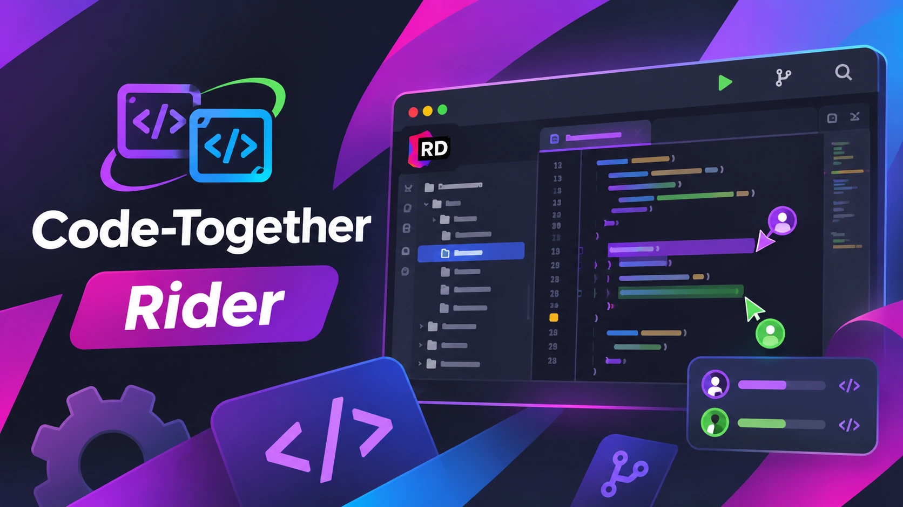

# Code Together for Rider

The planned Rider plugin will bring Code Together sessions into JetBrains Rider through Shared Perspective. The design includes shared chat and presence, teammate activity, and live code collaboration.

This repository is the home for the Rider adapter. Installation and build instructions will be added when a plugin build is available.

[Code Together overview](https://github.com/KD-Kevin/code-together) · [Shared Perspective](https://github.com/KD-Kevin/Shared-Perspective)
